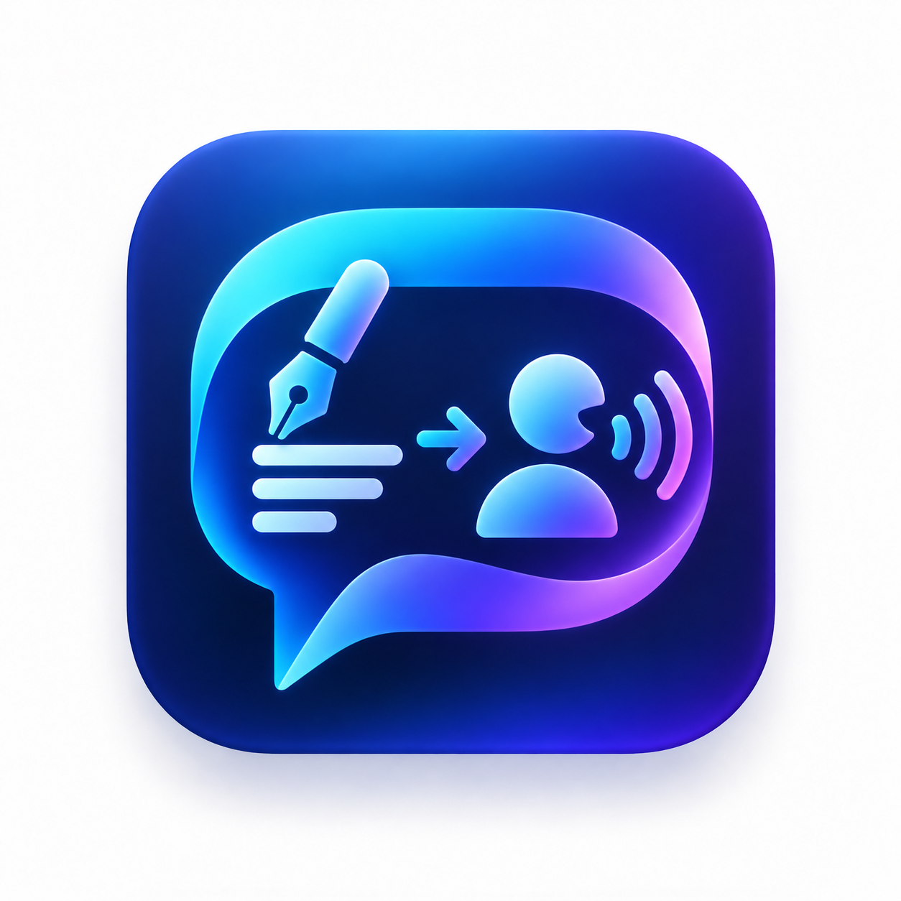
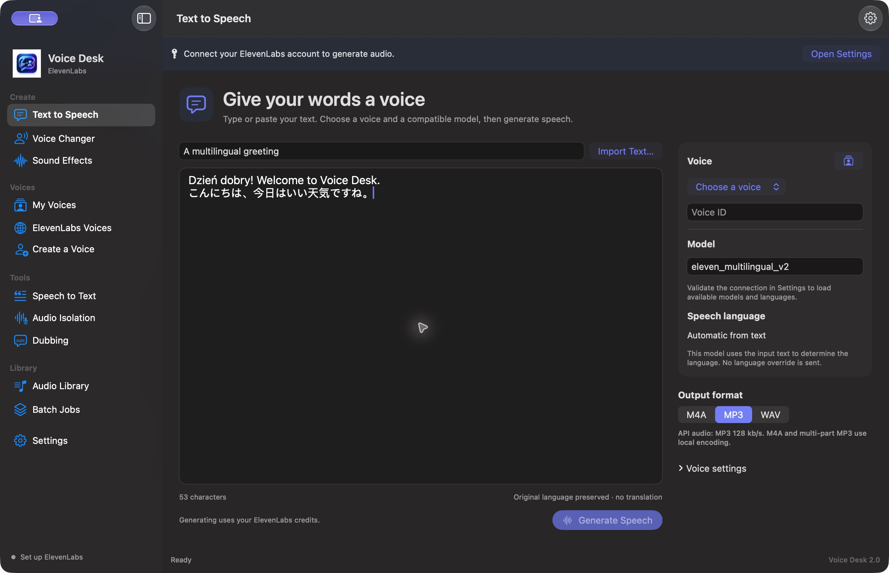

# Voice Desk



Voice Desk is a native macOS client for the official ElevenLabs API. It uses your ElevenLabs API key and the features available to that key. AI audio processing takes place at ElevenLabs; the app handles recording, playback, imports, exports, and the local job queue.

The app requires an Apple Silicon Mac running macOS 14 or later. Its interface supports English and Polish. The interface language and speech language are separate preferences: switching the interface does not translate your text or change the requested speech language.



## Build and install

Install Apple's Command Line Tools, then clone and build the repository:

```sh
git clone https://github.com/villainser/voice-desk.git
cd voice-desk
./build.sh build
open "build/Voice Desk.app"
```

The build uses SwiftUI, AppKit, AVFoundation, Security, and a vendored LAME library for MP3 encoding. No package manager or AI model download is required. The application is signed locally with an ad hoc signature; it is not notarized for distribution. You can copy the resulting app to Applications.

The test runner also requires Python 3 for the localization audit. Run `./test.sh` to compile and execute the mock API and local-media suites described in [TESTING.md](TESTING.md).

The LAME source archive and license are included. See [third-party notices](Resources/ThirdParty.txt) for rebuilding and relinking instructions.

## Connect ElevenLabs

Open **Settings → ElevenLabs API**, paste your key, and validate the connection. Manage key scopes in [ElevenLabs API settings](https://elevenlabs.io/app/developers/api-keys). Give the key access to the operations you intend to use; a valid key does not grant every feature or model.

The app stores saved credentials in macOS Keychain. It does not put the API key in UserDefaults, project files, or generation history. Settings lets you replace or remove the saved key. Account information reflects the API response and is refreshed on request; it is not a quote for the cost of a generation.

API requests use your ElevenLabs account allowance and any applicable billing rules. Importing files and playing existing previews do not start a generation request.

## Workflows

| Screen | Use it to |
| --- | --- |
| Text to Speech | Type, paste, or import text; choose a voice and model; generate spoken audio |
| Voice Changer | Import speech or record through the microphone, then convert it to a target voice |
| Sound Effects | Describe a sound, optionally choose a duration and looping, then generate it |
| My Voices | Search your saved, cloned, and created voices, preview them, and select a voice |
| ElevenLabs Voices | Select unsaved available voices or search the shared library to add more voices |
| Create a Voice | Design a voice from a description or submit samples for supported instant cloning |
| Speech to Text | Transcribe audio with ElevenLabs and save the resulting text |
| Audio Isolation | Send audio to ElevenLabs to isolate speech |
| Dubbing | Create and check an ElevenLabs translation/dubbing project, then download its result |
| Audio Library | Play and export local results or retrieve recordings from ElevenLabs history |
| Batch Jobs | Process imported text or audio files with per-file status and an explicit start action |

Voice editing and deletion are available only when the API explicitly confirms ownership. My Voices follows the API’s saved-voice list, including clones, created voices, saved library voices, and defaults explicitly added to a collection. Unsaved defaults appear under ElevenLabs Voices. The same source filter is available in Text to Speech, Voice Changer, and Batch Jobs. Saved membership does not imply personal ownership. Some operations require additional key permissions, account features, or verification by ElevenLabs.

### Generate speech from text

Choose **Text to Speech**, enter text, and select a voice and model. A saved or cloned voice is used through the same workflow. Select a supported speech language when the model provides an explicit language control, or leave automatic handling enabled. For example, Japanese text can be generated with the same selected voice when that model and voice support Japanese. The app preserves the input and does not translate it.

Voice settings are visible below Output format. Enable **Override voice defaults** to edit the model’s supported parameters; inactive controls are dimmed. Generate creates the full recording; playback and export become available after the download completes. The output choices are MP3, M4A, and WAV.

### Change an existing recording's voice

Choose **Voice Changer**, import a supported recording or press Record, and select the target voice. Stop recording before starting conversion. The microphone workflow requests macOS permission the first time it needs it. Noise removal is optional.

Voice Changer transforms the supplied performance. It does not generate replacement words from typed text, and it is not a translation tool. Use Text to Speech for new words and Dubbing for a separate translation workflow. Voice Changer inputs are limited to five minutes and 100 MB in this app.

### Record samples for voice cloning

Open **Create a Voice → Instant Voice Clone**. Select **System default input** or a named microphone, including a built-in mic or a connected USB, headset, or audio-interface input exposed by macOS. Refresh the list after connecting a device if needed. The choice is local to Voice Desk and does not change the system default.

Press **Record Microphone**, speak, then **Stop Recording**. Each finalized WAV is added to the sample list; you can record more samples, add audio files, play a sample, or remove it from the list. Removing a sample does not delete its local file. Samples stay on the Mac until you explicitly press **Create Voice Clone** after entering a name and confirming recording rights. Recording itself does not use ElevenLabs credits.

The same microphone selector is available in Voice Changer. A sample is limited to five minutes. A disconnected selected microphone is not replaced silently with another device; the app preserves any valid recorded part and asks you to choose an available input. Microphone permission is requested only when recording starts.

### Import files and run a batch

Import TXT, SRT, or VTT files through the native file picker or by dragging them from Finder. Multiple files and folders go into Batch Jobs. Folders are scanned one level deep; importing does not start generation. SRT/VTT import extracts spoken text in cue order and discards subtitle timing.

Text batches keep the source basename: `chapter.txt` can produce `chapter.mp3`. Audio conversion batches use a `Voice Changer` subfolder unless another destination is chosen. Existing outputs are skipped. If another supported audio format already exists under the same basename, the app converts that result locally without another API request. Choose a different destination or rename the source to generate a fresh performance with changed text or settings.

The queue stops on an error. Successful downloads remain cached, so an explicit retry can reuse them. Cancelling cannot reverse work already accepted or billed by ElevenLabs.

## Limits

- ElevenLabs is required for AI operations. Model availability, voice access, key scopes, subscription restrictions, and usage limits come from that service.
- Most generation workflows download MP3 at 44.1 kHz and 128 kbps. WAV is an uncompressed export of that downloaded audio, not a higher-quality generation request.
- Audio support also depends on what AVFoundation can decode on the Mac. A recognized extension does not guarantee a valid input.
- Generation is downloaded before playback; the app does not provide real-time speech streaming.
- Batch caches are written beside the source. Copy files out of a read-only location before generating them.
- API contract tests use mocks. See [the test report](TESTING.md) for live-service and hardware checks that have not been performed.

## Documentation

- [ElevenLabs capabilities and API contracts](ELEVENLABS_API.md)
- [Architecture and local data](ARCHITECTURE.md)
- [Testing and verification limits](TESTING.md)
- [Changes](CHANGELOG.md)

Voice Desk is an independent client and is not an official ElevenLabs application.
